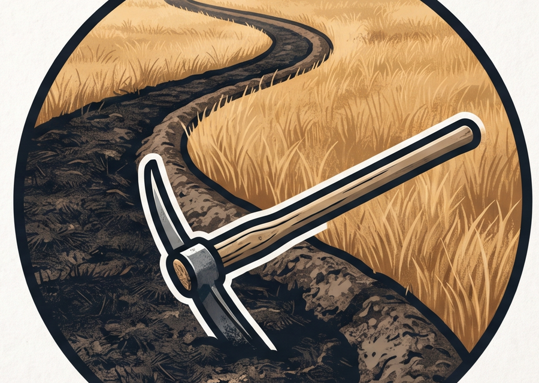

# config-Firewall-Rule-Analyzer

Title block: the name above is set in Big Shoulders Display in copper on a resist white inventory plate, the medium noted first. A small wax cake glyph stands beside this heading and beside no other: 🟠. The remaining headings keep the studio inventory treatment, medium noted first and a small cake glyph at major headings only, so that a long document stays quick to scan.

A command-line tool that parses firewall rules (iptables, firewalld, pfctl) from a specified file or system and analyzes them for redundancy and overly permissive rules, and reports a textual near duplicate hint between rules whose text is nested. Shadow detection compares rule text only and misses shadows whose texts are not nested, so it is a hint, not a field aware shadowed rule analysis. Outputs a report highlighting potential issues. - Focused on Tools for verifying that system or application configurations adhere to security best practices and policies. Scans configuration files, databases, or APIs for misconfigurations and vulnerabilities.

## Install

`git clone https://github.com/ShadowStrikeHQ/config-firewall-rule-analyzer`

> **Plate edge notice: flagged, not corrected.** The install line above names ShadowStrikeHQ. The repository lives under ShadowGuard-AI. The line is preserved as printed and flagged here, not mended inside it. The README gives no directory change and no dependency step. The program imports only the standard library. That fact closes part of the gap. It does not close the missing directory step.

## Usage

`./config-firewall-rule-analyzer [params]`

> **Plate edge notice: unusable as printed.** The usage line above names no argument. The true command, taken from main.py, is python3 main.py -f RULE_FILE -t TYPE. Both arguments are required. Buttons in the kit read Analyse a Rule File, Name the Rule Type, and Show Help.

## Parameters

- `-h`: Show help message and exit
- `-f`: Path to the firewall rule file.
- `-t`: No description provided

> **Plate edge notice: the list is short of the code.** The parameter list above names two flags only. In the code, -f has the long form --file and is required, and -t has the long form --type, is required, and takes the choices iptables, firewalld, and pfctl. Headings on this page read Three Types, Named Not Detected, What the Parsers Drop, A Hint Is Not a Shadow Check, and Findings Exit 0. Two callouts stand on this page: No Rules Parsed Ends the Run, and The Whole Word Any, and the Unrestricted Range.

## License

Copyright (c) ShadowStrikeHQ

> **Plate edge notice: flagged, not corrected.** The licence line above names ShadowStrikeHQ, its second appearance in this file: ShadowStrikeHQ appears 2 times in the live README, once in the install line and once here. The licence section gives no licence name. GitHub records the licence as MIT, stated here as GitHub record, not as README text.

> **The cooled panel, the last entry.** The bench, stated whole: config-firewall-rule-analyzer reads a rule file. It reports exact duplicate rules. It reports textual near duplicate hints. It reports rules that look overly permissive. It prints the report. Findings do not change the exit code. A flagged file exits 0. A clean file exits 0. The printed report is the result. The caller names the type. Nothing is detected. -t is required. Its choices are iptables, firewalld, and pfctl. Iptables keeps lines beginning -A. Firewalld keeps lines beginning with a rule element opening tag. Pfctl keeps lines beginning pass or block. A file parsed under the wrong type yields no rules. No rules means exit 1. python3 main.py -f RULE_FILE -t TYPE Both arguments are required. A repeated rule line draws one redundancy line per repeat. An earlier rule whose text sits inside a later rule draws a hint line. The hint names both rules. It is a text match only. It is not a field aware shadow check. Equal rules are skipped by this check. A rule holding the whole word any draws a line. A rule holding the unrestricted address range draws a line. No severity is attached. No remedy is attached. Iptables chain creation lines are dropped. Default policies are dropped. Counters are dropped. A firewalld rule spanning several lines keeps its opening line only. Its action, on a later line, never reaches the checks. Missing file: error logged, exit 1. File read, no rules parsed: error logged, exit 1. Report printed, issues or none: exit 0. Exit codes here report whether the run worked. They do not report whether the rules were sound. The unrestricted address range is written 0.0.0.0/0 in the code. The plate is switched off, the pots are skinned over, and the panel surface is hard, ridged, and final.
